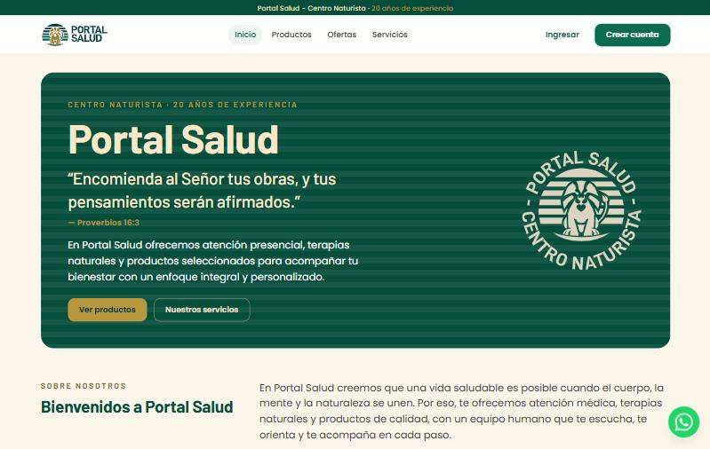
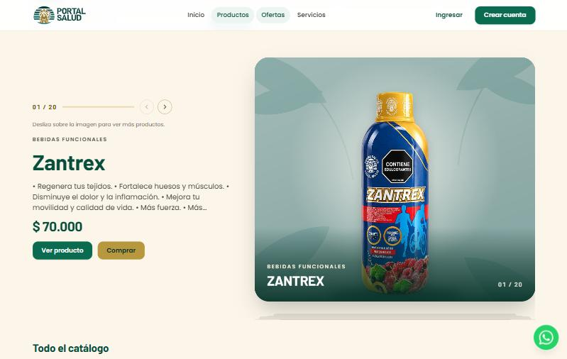
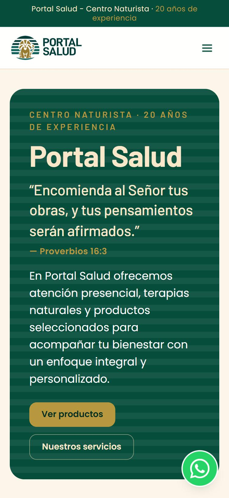

# Portal Salud · Centro Naturista

Tienda en línea y sitio institucional de **Portal Salud**, un centro naturista con 20 años de experiencia. Los clientes conocen los servicios, recorren el catálogo de productos naturales y hacen su pedido con pago contra entrega. El equipo del centro administra productos, pedidos y clientes desde su propio panel.

**Sitio en vivo:** [portalsalud.com.co](https://portalsalud.com.co)

| Catálogo animado | En el celular |
| --- | --- |
|  |  |

## Qué incluye

- **Identidad de marca** llevada a la web a partir del manual del cliente: colores, tipografía y el sello del león.
- **Catálogo animado**: una pila de productos que se recorre deslizando hacia los lados, además de la grilla completa con filtros por categoría, búsqueda y ofertas.
- **Carrusel de destacados** en el inicio y **pantalla de carga** con la marca.
- **Compra contra entrega**, cuentas de cliente e historial de pedidos.
- **Panel de administración** para productos, pedidos (con guía de envío imprimible) y clientes.
- **Diseño responsive** revisado en celular, tablet y computador, respetando a quienes prefieren menos animaciones.

## Stack

| Capa | Tecnologías |
| --- | --- |
| Frontend | React 19 · TypeScript · Vite · Tailwind CSS 4 · TanStack Query · GSAP · Zod |
| Backend | Node.js · Express 5 · Prisma · PostgreSQL · Zod |
| Infraestructura | Docker Compose en un Droplet de DigitalOcean · Caddy (HTTPS) · respaldos automáticos · Cloudflare Pages |

## Mi aporte

Proyecto hecho en equipo con [@dante312w](https://github.com/dante312w). Mi parte se centró en el **frontend**: la identidad de marca en la web, el catálogo animado, el carrusel y la pantalla de carga, la experiencia de compra, la interfaz del panel de administración y la experiencia en celular.

## Código

El código es privado porque es un proyecto de cliente. Este repositorio es solo una vitrina del trabajo.
